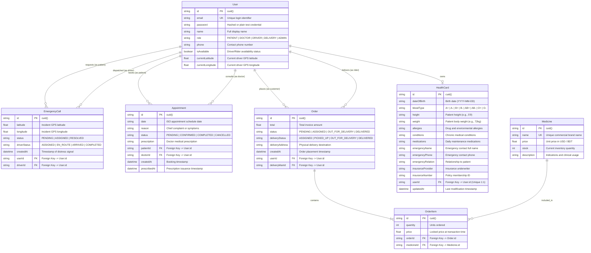

# Medical SOS — Real-Time Emergency Dispatch, Telemedicine & Pharmacy Management System

[](https://nextjs.org/)
[](https://react.dev/)
[](https://www.typescriptlang.org/)
[](https://tailwindcss.com/)
[](https://www.prisma.io/)
[](https://neon.tech/)
[](https://vercel.com/)

---

### Academic Information & Course Metadata

| Field | Details |
| :--- | :--- |
| **Course Title** | **CSE370: Database Systems** |
| **Semester** | **Fall 2025** |
| **Institution** | **Department of Computer Science and Engineering, BRAC University** |
| **Project Author** | **Monowar Husain, MD. HIMEL SARKER, Sinthia Siddique Borsha** |
| **Student ID** | **`22301098`** |
| **Live Production URL** | [https://medical-sos-one.vercel.app](https://medical-sos-one.vercel.app) |
| **Database Status Check** | [https://medical-sos-one.vercel.app/api/health](https://medical-sos-one.vercel.app/api/health) |

---

## 1. Executive Summary

**Medical SOS** is an enterprise-grade full-stack healthcare platform engineered for the **CSE370 Database Systems** curriculum at BRAC University. It unifies three mission-critical medical services into a centralized, low-latency, relational system:

1. **One-Tap Emergency SOS & Real-Time Ambulance Dispatch:** Immediate distress signaling with device GPS capture, fallback geolocation for Dhaka coordinates, automated queue management, and live fleet assignment.
2. **Telemedicine & Digital Consultation Platform:** Patient-doctor scheduling, consultation status lifecycle, and timestamped digital prescription issuance stored directly in PostgreSQL.
3. **Integrated Pharmacy & Doorstep Medicine Delivery:** Real-time medicine inventory tracking, multi-item shopping carts, order fulfillment workflows, and dedicated delivery rider assignment.

The platform implements **Role-Based Access Control (RBAC)** across **5 distinct user personas** (`PATIENT`, `DOCTOR`, `DRIVER`, `DELIVERY`, `ADMIN`), featuring a real-time database state synchronization engine and an on-screen **Live Instant DB Role Changer** built specifically for live viva demonstrations.

---

## 2. System Architecture & Tech Stack

```
┌────────────────────────────────────────────────────────────────────────┐
│                        Next.js 16 App Router UI                        │
│          (React 19 Server/Client Components + Tailwind CSS 4)          │
└───────────────────────────────────┬────────────────────────────────────┘
                                    │
           Direct RPC Invocations   │   Short Polling Sync (2-3s)
              via Server Actions    │   + revalidatePath Invalidation
                                    ▼
┌────────────────────────────────────────────────────────────────────────┐
│                     Next.js Server Actions Layer                       │
│              (Server-side Mutations & Data Serialization)              │
└───────────────────────────────────┬────────────────────────────────────┘
                                    │
                                    │  Prisma ORM 5.10.2
                                    │  (native & rhel-openssl-3.0.x)
                                    ▼
┌────────────────────────────────────────────────────────────────────────┐
│                   Neon Serverless PostgreSQL Database                  │
│       Pooled Connection (-pooler) • AWS us-east-1 • SSL Required       │
└────────────────────────────────────────────────────────────────────────┘
```

### Technology Matrix

| Layer | Technology | Specification / Version | Role in System |
| :--- | :--- | :--- | :--- |
| **Frontend Framework** | **Next.js** | `v16.1.1` (App Router) | Hybrid Server & Client Component rendering, Turbopack bundling |
| **UI Library** | **React** | `v19.2.3` | Concurrent rendering, `useTransition`, `useCallback`, state hooks |
| **Language** | **TypeScript** | `v5.x` | Strict end-to-end static typing across database schemas and UI actions |
| **Styling** | **Tailwind CSS** | `v4.0.0` | Accessible, responsive dark-mode emergency console styling |
| **ORM** | **Prisma Client** | `v5.10.2` | Type-safe query building, relational joins, automated migrations |
| **Database** | **PostgreSQL (Neon)** | Serverless Postgres | Cloud relational persistence with connection pooling (`-pooler`) |
| **Hosting Platform** | **Vercel** | Edge & Serverless Runtime | Production continuous integration and automatic deployment |

### Core Architectural Pillars

1. **Next.js Server Actions (RPC Architecture):** Mutations (`triggerSOS`, `bookAppointment`, `submitPrescription`, `placeOrder`, `switchUserRole`, etc.) execute entirely on the server with zero client-exposed API keys, returning recursively date-serialized JSON to eliminate RSC hydration mismatches.
2. **Near Real-Time Data Synchronization:** Rather than relying on heavyweight persistent WebSocket connections that drop on serverless sleep cycles, dashboards utilize an optimized **2.0–3.0 second short-polling cadence** backed by `revalidatePath` server cache invalidation.
3. **Graceful GPS Fallback Strategy:** If a patient's browser denies HTML5 Geolocation permission or encounters a timeout, the dispatch system automatically assigns central **Dhaka coordinates** (`23.8103, 90.4125`) as a fallback, ensuring emergency signal transmission is never blocked by browser hardware restrictions.
4. **Vercel Serverless & Neon Connection Resiliency:** Configured with dual Prisma binary targets (`native` and `rhel-openssl-3.0.x`), pooled endpoint strings, and `connect_timeout=15` to gracefully absorb cold starts without dropping transactions.

---

## 3. Database Schema & Entity-Relationship Design

The relational database is modeled in `prisma/schema.prisma` and deployed onto Neon PostgreSQL. It enforces strict relational integrity, foreign key cascading, and unique constraints.

### Mermaid Entity-Relationship (ER) Diagram



### Table Specifications & Cardinalities

1. **`User` (Core Identity & RBAC Table):**
   - **Primary Key:** `id` (`String` generated via `cuid()`).
   - **Unique Constraints:** `email` (`String`).
   - **Cardinality:**
     - `1:N` with `EmergencyCall` via `calls` (patient side) and `assignedCalls` (driver side).
     - `1:N` with `Appointment` via `appointmentsAsPatient` and `appointmentsAsDoctor`.
     - `1:N` with `Order` via `orders` (customer) and `assignedOrders` (delivery rider).
     - `1:1` with `HealthCard` via `healthCard`.
2. **`EmergencyCall` (Ambulance Dispatch Queue):**
   - Coordinates (`latitude`, `longitude`) store double-precision GPS floats.
   - Foreign keys map both the caller (`userId`) and the assigned driver (`driverId`).
3. **`Appointment` (Clinical Telemedicine Engine):**
   - Foreign keys link `patientId` and `doctorId`.
   - Stores consultation reason, status (`PENDING`, `CONFIRMED`, `COMPLETED`), prescription text, and timestamps.
4. **`Medicine` & `OrderItem` & `Order` (Pharmacy E-Commerce & Inventory):**
   - `Order` holds aggregate invoice totals and delivery status.
   - `OrderItem` serves as the normalized associative entity resolving the `M:N` relationship between `Order` and `Medicine`, capturing purchase-time unit prices.
5. **`HealthCard` (Digital Emergency Medical Passport):**
   - Enforces a strict `1:1` relationship with `User` (`userId` marked `@unique`).
   - Persists vital medical baseline information (blood type, allergies, chronic ailments, emergency contacts, and insurance IDs).

---

## 4. Role-Based Access Control (5 Roles) & Dedicated Portals

The application implements deterministic role routing via `lib/roleRoutes.ts`. Each role accesses a dedicated dashboard designed for their exact operational domain:

```
                      Role Route Mapping Table
  ┌───────────────────┬──────────────────────┬───────────────────────┐
  │ Role              │ Designated Route     │ Fallback Target       │
  ├───────────────────┼──────────────────────┼───────────────────────┤
  │ PATIENT           │ /patient             │ /login                │
  │ DOCTOR            │ /appointments        │ /login                │
  │ DRIVER            │ /driver              │ /login                │
  │ DELIVERY          │ /delivery            │ /login                │
  │ ADMIN             │ /admin               │ /login                │
  └───────────────────┴──────────────────────┴───────────────────────┘
```

### 1. `PATIENT` Portal (`/patient`, `/appointments`, `/pharmacy`, `/healthcard`, `/profile`)
- **Emergency SOS Command:** High-contrast, one-tap emergency button with live device GPS capture, fallback coordinates (`23.8103, 90.4125`), and real-time status tracker (`LOCATING` -> `WAITING` -> `DISPATCHED`).
- **Telemedicine Booking:** View verified doctors, schedule consultation slots, review completed visit histories, and access doctor-prescribed treatment plans.
- **Online Pharmacy:** Browse commercial pharmaceutical stocks, add items to a dynamic shopping cart, enter destination addresses, and view live delivery progress.
- **Emergency Health Card:** Manage digital blood type, allergies, medications, and next-of-kin contact details for emergency responders.

### 2. `DOCTOR` Portal (`/appointments`)
- **Clinical Queue:** Real-time visibility into all booked and pending patient consultations.
- **Consultation Management:** Confirm appointments, examine patient complaint logs, and complete visits.
- **Digital Prescription Pad:** Direct writing and submission of medical prescriptions, immediately saving to PostgreSQL and making them available in the patient's portal.

### 3. `DRIVER` Portal (`/driver`)
- **Fleet Availability Toggle:** Instant switch between `On Duty (Available)` and `Off Duty`.
- **Live Dispatch Queue:** Auto-refreshing list of emergency distress signals assigned to the driver.
- **Incident Lifecycle Actions:** Sequential state transitions (`EN_ROUTE` -> `ARRIVED ON SCENE` -> `COMPLETED / RESOLVED`).

### 4. `DELIVERY` Portal (`/delivery`)
- **Rider Availability Toggle:** Mark rider available or offline for pharmacy package runs.
- **Order Fulfillment Pipeline:** Live assigned medicine deliveries displaying destination address, customer phone, and order amount.
- **Delivery Lifecycle Actions:** Progress package states (`PICKED_UP` -> `OUT_FOR_DELIVERY` -> `DELIVERED`).

### 5. `ADMIN` Portal (`/admin` and sub-dashboards)
- **Central Dispatch Center (`/admin`):** Global emergency distress board with unassigned calls, available ambulance driver fleet, and one-click manual driver dispatching.
- **Doctors Management (`/admin/doctors`):** Directory of verified physicians and their consultation volumes.
- **Patients Directory (`/admin/patients`):** Master patient index with registered phones, emergency health cards, and active medical records.
- **Appointments Oversight (`/admin/appointments`):** Full historical audit log of all completed, confirmed, and pending consultations.
- **Ambulance Fleet (`/admin/drivers`):** Real-time GPS coordinates and duty status for all drivers.
- **Pharmacy Inventory (`/admin/pharmacy`):** Live medicine catalog management with stock editing, unit price controls, and medicine creation/deletion.
- **Delivery Operations (`/admin/orders`):** Global order tracking, rider assignment, and delivery verification.

---

## 5. Live Viva Demonstration Tools

To facilitate examination, grading, and live interactive evaluation, the platform includes two purpose-built demonstration mechanisms:

### A. Live On-Screen Instant DB Role Changer & Profile Switcher (`LiveRoleSwitcher.tsx`)
Located persistently in the top navigation bar across all authenticated routes:
- **Instant Database Role Mutation:** Clicking any of the 5 role badges (`Patient`, `Doctor`, `Driver`, `Delivery`, `Admin`) executes the `switchUserRole` server action, updating the `User.role` column directly in Neon PostgreSQL in real time.
- **1-Click 9-Account Profile Switcher:** A dropdown selector containing all 9 seeded user accounts. Selecting an account instantly logs in as that user without typing passwords, updating `localStorage` and routing to the user's home dashboard.
- **Cross-Component Event Synchronization:** Dispatches `user-session-updated` and `user-state-change` browser events so all open UI components synchronize without requiring manual page reloads.

### B. Pre-Seeded Historical Records (December 2025 & January 2026)
To demonstrate that the system handles long-term historical records and analytics, the database seed (`prisma/seed.ts`) populates backdated data:
- **Historical Emergency Calls:** Completed ambulance runs in Dhaka (Gulshan, Dhanmondi, Banani, Karwan Bazar, Azimpur) from Dec 2025 and Jan 2026.
- **Historical Clinical Consultations:** Finished telemedicine appointments with complete medical prescriptions dated Dec 14, 2025; Dec 28, 2025; Jan 09, 2026; and Jan 22, 2026.
- **Historical Pharmacy Orders:** Completed and delivered medicine deliveries spanning Dec 15, 2025 through Jan 23, 2026.

---

## 6. Seeded Demo Accounts (Ready for Viva & Testing)

All accounts are pre-seeded in the database with the shared password: **`123456`**.

| Group | Email | Password | Role | Default Route | Pre-Seeded Data / Purpose |
| :--- | :--- | :--- | :--- | :--- | :--- |
| **Patients** | `pat1@test.com` | `123456` | `PATIENT` | `/patient` | Patient 1 (Dhanmondi). Has active PENDING SOS call, completed appointments, health card, and delivered order. |
| **Patients** | `pat2@test.com` | `123456` | `PATIENT` | `/patient` | Patient 2 (Banani). Has active ASSIGNED emergency call, active OUT_FOR_DELIVERY pharmacy order. |
| **Doctors** | `doc1@test.com` | `123456` | `DOCTOR` | `/appointments` | Dr. Doctor 1 (General Physician). Has completed prescriptions and confirmed upcoming visits. |
| **Doctors** | `doc2@test.com` | `123456` | `DOCTOR` | `/appointments` | Dr. Doctor 2 (Cardiologist). Has routine follow-up consultations and prescription records. |
| **Ambulance Drivers** | `dri1@test.com` | `123456` | `DRIVER` | `/driver` | Driver 1 (Central Dhaka). Available on duty with assigned historical ambulance runs. |
| **Ambulance Drivers** | `dri2@test.com` | `123456` | `DRIVER` | `/driver` | Driver 2 (Banani). Currently assigned to Patient 2's active emergency call. |
| **Delivery Riders** | `deli1@test.com` | `123456` | `DELIVERY` | `/delivery` | Delivery Rider 1. Completed historical medicine deliveries. |
| **Delivery Riders** | `deli2@test.com` | `123456` | `DELIVERY` | `/delivery` | Delivery Rider 2. Currently assigned to Patient 2's active out-for-delivery pharmacy order. |
| **Administration** | `admin@test.com` | `123456` | `ADMIN` | `/admin` | System Administrator. Unrestricted access to central dispatch, fleet oversight, and pharmacy inventory. |

> **Note on Aliases:** For backward compatibility, legacy single-account aliases (`patient@test.com`, `doctor@test.com`, `driver@test.com`, `delivery@test.com`) are also preserved in the database with password `123456`.

---

## 7. Pre-Seeded Pharmaceutical Catalog

| Medicine Name | Unit Price (USD) | Initial Stock | Clinical Indication |
| :--- | :--- | :--- | :--- |
| **Napa 500mg** | $1.20 | 150 units | Fast relief from fever, headache, body aches and minor pains. |
| **Seclo 20mg** | $5.50 | 90 units | Omeprazole for heartburn, GERD, and gastric hyperacidity control. |
| **Sergel 20mg** | $7.00 | 85 units | Esomeprazole for acid reflux, indigestion, and peptic ulcer healing. |
| **Monas 10mg** | $16.00 | 60 units | Montelukast for asthma management and seasonal allergy prevention. |
| **Ace Plus** | $2.50 | 110 units | Paracetamol & Caffeine combination for fast relief of severe headaches. |
| **Fexo 120mg** | $9.00 | 75 units | Fexofenadine non-drowsy antihistamine for allergic rhinitis and hives. |

---

## 8. Local Setup & Installation Guide

### Prerequisites
- **Node.js:** `v20.x` or higher
- **npm:** `v10.x` or higher
- **PostgreSQL Database:** Neon Serverless PostgreSQL instance or local PostgreSQL instance

### Step-by-Step Installation

1. **Clone the Repository:**
   ```bash
   git clone https://github.com/MonowarHusain/medical-sos.git
   cd medical-sos
   ```

2. **Install Node Dependencies:**
   ```bash
   npm install
   ```

3. **Configure Environment Variables:**
   Copy the example environment configuration:
   ```bash
   cp .env.example .env
   ```
   Edit `.env` to supply your Neon PostgreSQL pooled connection string:
   ```env
   DATABASE_URL="postgresql://<user>:<password>@<neon-pooler-host>/medical_sos?sslmode=require&connect_timeout=15"
   ```

4. **Synchronize Prisma Schema & Generate Client:**
   ```bash
   npx prisma generate
   npx prisma db push
   ```

5. **Seed the Demonstration Database:**
   ```bash
   npx prisma db seed
   ```
   *This command provisions all 9 user accounts, Health Cards, pharmaceutical inventory, active calls, and Dec 2025 / Jan 2026 historical records.*

6. **Start the Development Server:**
   ```bash
   npm run dev
   ```
   Open [http://localhost:3000](http://localhost:3000) in your browser.

7. **Production Verification Build:**
   ```bash
   npm run build
   npm run start
   ```

---

## 9. Vercel & Neon Production Deployment Checklist

1. **Repository Link:** Import the GitHub repository into your Vercel project dashboard.
2. **Environment Variable Configuration:**
   - In Vercel Project Settings -> **Environment Variables**, set:
     - `DATABASE_URL`: Your Neon pooled connection string (with `-pooler`, `?sslmode=require`, and `&connect_timeout=15`).
3. **Build & Install Settings:**
   - Framework Preset: `Next.js`
   - Build Command: `prisma generate && next build`
   - Install Command: `npm install`
4. **Health Check Verification:**
   - Following deployment, verify the live database handshake by navigating to:
     `https://<your-vercel-domain>/api/health`
   - A healthy connection returns:
     ```json
     {
       "ok": true,
       "dbConnected": true,
       "userCount": 9
     }
     ```

---

## 10. Repository File Structure

```
medical-sos/
├── app/
│   ├── actions.ts                  # Type-safe Next.js Server Actions (all async DB queries)
│   ├── layout.tsx                  # Root HTML layout with Navbar & LiveRoleSwitcher
│   ├── page.tsx                    # Root routing entry point with localStorage role redirect
│   ├── globals.css                 # Tailwind CSS 4 style imports and theme variables
│   ├── error.tsx                   # Global application boundary error component
│   ├── api/
│   │   └── health/
│   │       └── route.ts            # Database diagnostic and connectivity verification endpoint
│   ├── login/
│   │   └── page.tsx                # Universal login portal supporting all 5 user roles
│   ├── patient/
│   │   └── page.tsx                # Patient dashboard: One-tap SOS, GPS fallback & dispatch queue
│   ├── appointments/
│   │   └── page.tsx                # Telemedicine portal: Booking, doctor queue & prescription issuance
│   ├── pharmacy/
│   │   └── page.tsx                # Online pharmacy: Medicine catalog, shopping cart & order tracker
│   ├── healthcard/
│   │   └── page.tsx                # Digital health card: Vitals, allergies, emergency contacts & insurance
│   ├── driver/
│   │   └── page.tsx                # Ambulance driver portal: Duty toggle, GPS sync & call resolution
│   ├── delivery/
│   │   └── page.tsx                # Pharmacy rider portal: Duty toggle & multi-stage order delivery
│   ├── profile/
│   │   └── page.tsx                # User profile and account credentials management
│   ├── components/
│   │   ├── Navbar.tsx              # Role-aware responsive navigation bar with badge counters
│   │   └── LiveRoleSwitcher.tsx    # Live on-screen instant DB role mutator & demo account switcher
│   └── admin/
│       ├── layout.tsx              # Admin sidebar layout with real-time pending notification badges
│       ├── page.tsx                # Central Emergency SOS dispatch command center
│       ├── doctors/page.tsx        # Doctor directory and consultation volume oversight
│       ├── patients/page.tsx       # Patient registry and medical history review
│       ├── appointments/page.tsx   # Comprehensive telemedicine consultation audit log
│       ├── drivers/page.tsx        # Ambulance fleet roster, on-duty status & GPS coordinates
│       ├── pharmacy/page.tsx       # Pharmacy inventory management (add/edit/delete medicine)
│       ├── orders/page.tsx         # Delivery fulfillment operations and rider assignments
│       └── profile/page.tsx        # Admin credentials and personal profile
├── lib/
│   ├── constants.ts                # Shared runtime constants (VALID_ROLES, ValidRole, etc.)
│   ├── prisma.ts                   # Resilient PrismaClient singleton with string sanitation
│   └── roleRoutes.ts               # Deterministic role-to-route resolver helper
├── prisma/
│   ├── schema.prisma               # PostgreSQL relational models, relations & binary targets
│   └── seed.ts                     # Multi-user seed script with historical Dec 2025/Jan 2026 data
├── public/                         # Static assets and icons
├── package.json                    # Project metadata, dependencies and build scripts
├── .env.example                    # Template environment variables
└── README.md                       # Comprehensive course documentation & viva reference
```

---

## 11. Academic Integrity & Course Declaration

This project was conceived, designed, and implemented by **Monowar Husain** (`22301098`) for **CSE370: Database Systems** (Fall 2025) at **BRAC University**. All relational schemas, entity relationships, server actions, client dashboards, and viva demonstration tools were constructed specifically to demonstrate practical mastery of database normalization, relational querying, integrity constraints, and modern full-stack web architectures.
